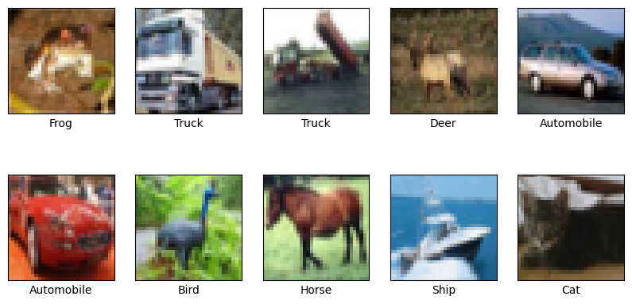
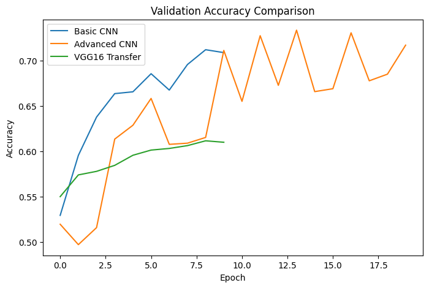
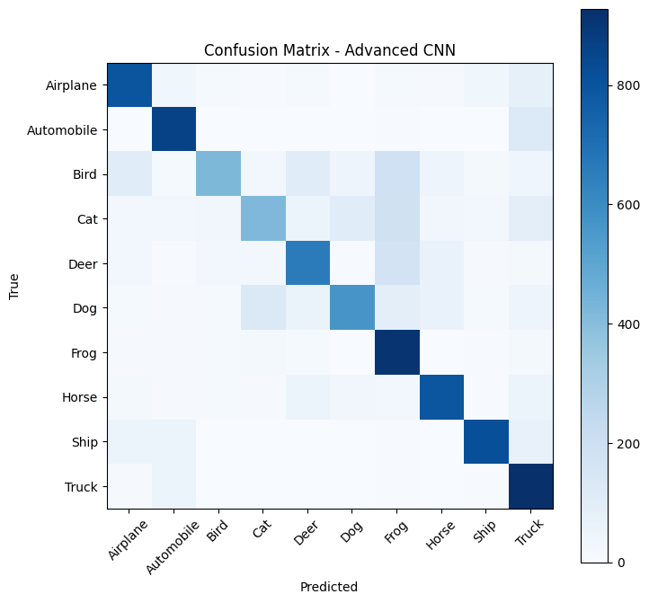

# CIFAR-10 Image Classification

Image classification on the CIFAR-10 dataset using TensorFlow/Keras, comparing three approaches:

1. **Basic CNN**: three convolutional layers with a dense classifier.
2. **Advanced CNN**: adds BatchNormalization, Dropout, and data augmentation.
3. **VGG16 Transfer Learning**: a frozen ImageNet-pretrained VGG16 base with a custom classifier.

## Dataset

[CIFAR-10](https://www.cs.toronto.edu/~kriz/cifar.html) contains 60,000 color images (32x32) in 10 classes:
Airplane, Automobile, Bird, Cat, Deer, Dog, Frog, Horse, Ship, Truck.
The split is 50,000 training images and 10,000 test images. Pixel values are normalized to the [0, 1] range.



## Models

| Model | Details | Epochs |
|-------|---------|--------|
| Basic CNN | 3x Conv2D (32, 64, 64), 2x MaxPooling, Dense(64) | 10 |
| Advanced CNN | 2x Conv2D (32, 64) + BatchNorm + Dropout, Dense(128), augmentation (rotation, shifts, horizontal flip) | 20 |
| VGG16 Transfer | Frozen VGG16 base, Dense(256) + Dropout(0.5) | 10 |

## Results

| Model | Test Accuracy | Test Loss |
|-------|---------------|-----------|
| Basic CNN | 70.86% | 0.8517 |
| **Advanced CNN** | **71.68%** | **0.8187** |
| VGG16 Transfer | 61.00% | 1.1137 |



### Best model: Advanced CNN

| Class | Precision | Recall | F1-score |
|-------|-----------|--------|----------|
| Airplane | 0.75 | 0.80 | 0.77 |
| Automobile | 0.80 | 0.86 | 0.83 |
| Bird | 0.80 | 0.42 | 0.55 |
| Cat | 0.67 | 0.42 | 0.52 |
| Deer | 0.69 | 0.66 | 0.67 |
| Dog | 0.74 | 0.56 | 0.64 |
| Frog | 0.57 | 0.91 | 0.70 |
| Horse | 0.78 | 0.79 | 0.79 |
| Ship | 0.87 | 0.82 | 0.84 |
| Truck | 0.63 | 0.93 | 0.75 |



## Key Observations

- The Advanced CNN gave the best accuracy, and its test loss was also the lowest of the three.
- Ship and Automobile were the easiest classes to classify, while Cat and Bird were the hardest (recall of only 0.42).
- VGG16 performed worst. It was pretrained on 224x224 images, and the 32x32 CIFAR-10 images give its frozen layers very little spatial detail to work with.

## Future Improvements

- Resize images (e.g. 64x64 or 96x96) before feeding them to VGG16, and fine-tune its top layers.
- Use a separate validation split instead of validating on the test set.
- Train longer with learning-rate scheduling and EarlyStopping.
- Try deeper architectures such as ResNet or EfficientNet.

## Installation

```bash
git clone https://github.com/Habiba-elgamal158/cifar10-image-classification.git
cd cifar10-image-classification
pip install -r requirements.txt
```

## Usage

Open and run the notebook:

Or run it directly on Google Colab (a GPU runtime is recommended). The last cell saves the best model as `best_cifar10_model.keras`.

## Author

[Habiba-elgamal158](https://github.com/Habiba-elgamal158)

## Tech Stack

Python, TensorFlow/Keras, NumPy, Matplotlib, scikit-learn
